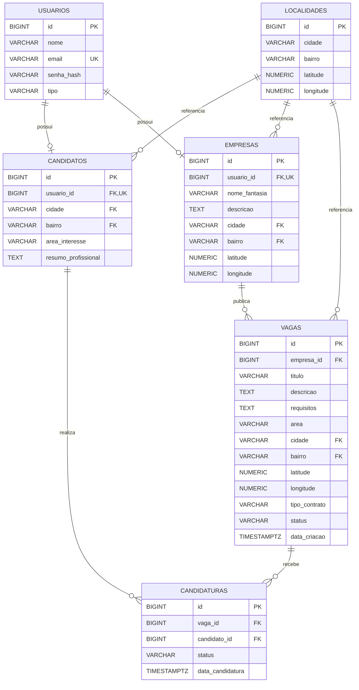

# Diagrama Entidade-Relacionamento

O diagrama representa as seis tabelas principais do banco de dados Emprego Perto de Você e seus relacionamentos.

## Observações

- `localidades`: possui uma restrição UNIQUE composta por cidade e bairro.
- `candidatos`, `empresas` e `vagas`: utilizam chaves estrangeiras compostas por cidade e bairro para referenciar `localidades`.
- `usuario_id` é único em candidatos e empresas, permitindo no máximo um perfil de cada tipo por usuário.