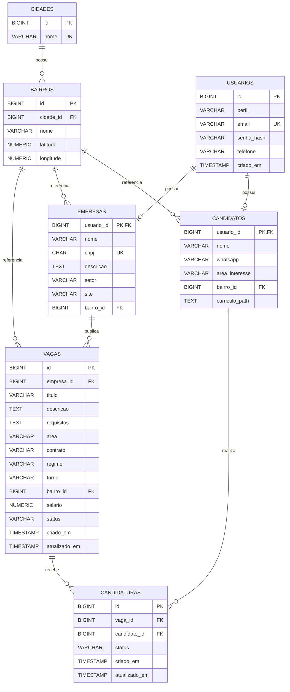

# Diagrama Entidade-Relacionamento

O diagrama representa as sete tabelas do banco de dados **Emprego Perto de Você**, seus atributos e relacionamentos.

## Diagrama

## Relacionamentos

- **Cidades e bairros:** uma cidade pode possuir vários bairros, mas cada bairro pertence a uma única cidade.
- **Bairros e candidatos:** um bairro pode estar associado a vários candidatos.
- **Bairros e empresas:** um bairro pode estar associado a várias empresas.
- **Bairros e vagas:** um bairro pode possuir várias vagas cadastradas.
- **Usuários e candidatos:** um usuário pode possuir um perfil de candidato.
- **Usuários e empresas:** um usuário pode possuir um perfil de empresa.
- **Empresas e vagas:** uma empresa pode publicar várias vagas.
- **Candidatos e candidaturas:** um candidato pode realizar várias candidaturas.
- **Vagas e candidaturas:** uma vaga pode receber várias candidaturas.

## Restrições e regras de integridade

- `bairros`: possui uma restrição UNIQUE composta por `cidade_id` e `nome`, impedindo bairros duplicados na mesma cidade.
- `candidatos` e `empresas`: utilizam `usuario_id` como chave primária e estrangeira, vinculando diretamente o perfil à conta de usuário.
- **Perfis de usuário:** cada conta possui um único tipo de perfil, candidato ou empresa. Triggers validam a compatibilidade entre o perfil cadastrado e sua tabela correspondente.
- `empresas`: possui CNPJ único, com validação dos dígitos verificadores.
- `vagas`: pertence obrigatoriamente a uma empresa e a um bairro.
- `candidaturas`: possui uma restrição UNIQUE composta por `vaga_id` e `candidato_id`, impedindo que o mesmo candidato se candidate mais de uma vez à mesma vaga.
- `salario`: é opcional, mas deve ser maior que zero quando informado.
- `atualizado_em`: é atualizado automaticamente por triggers quando uma vaga ou candidatura é modificada.

## Informações geográficas

As coordenadas de latitude e longitude são armazenadas na tabela `bairros`, representando a localização geográfica aproximada de cada bairro.

A extensão PostGIS é utilizada para permitir consultas espaciais, como buscas de vagas próximas a determinada localização.